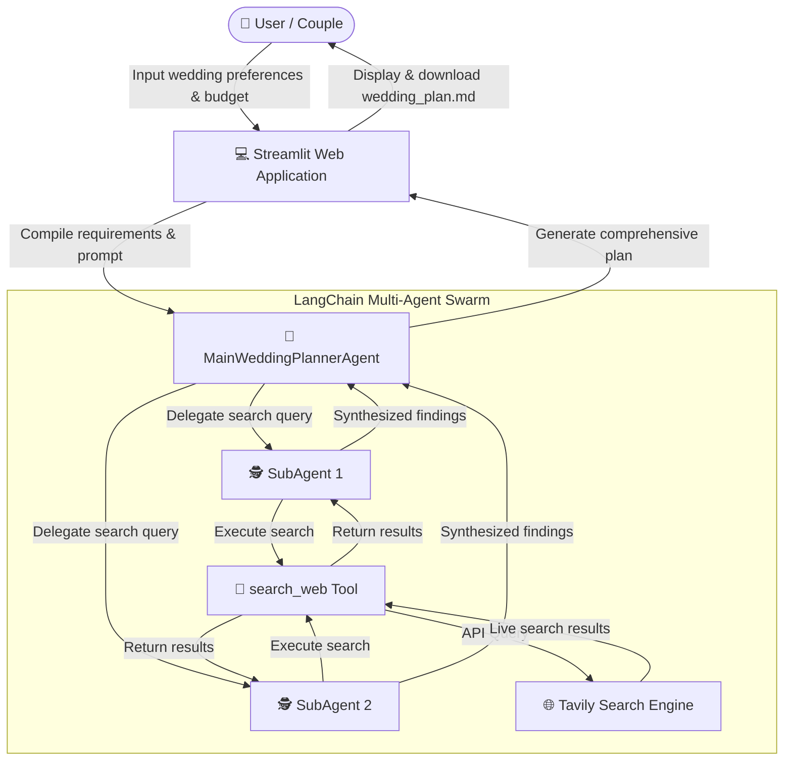

# 💍 Multi-Agent AI Wedding Planner

[](https://www.python.org/)
[](https://www.langchain.com/)
[](https://streamlit.io/)
[](LICENSE)

An intelligent, collaborative **Multi-Agent Wedding Planning System** built with **LangChain**, **OpenRouter**, **Tavily Web Search**, and **Streamlit**.

Planning a wedding requires balancing budgets, venues, catering, themes, photography, and timelines. This application uses a hierarchical multi-agent architecture where a primary wedding coordinator coordinates specialized subagents that search the live web to deliver a realistic, highly personalized wedding proposal.

---

## 🌟 Key Features

- **🧠 Hierarchical Multi-Agent Architecture**: A primary planner orchestrates tasks and delegates research to dedicated subagents.
- **🌐 Real-Time Live Web Search**: Integrated with **Tavily Search API** to fetch up-to-date venue options, vendor pricing, and local ideas.
- **🎨 Sleek Streamlit Interface**: A custom-styled, elegant dark-rose theme designed for couples and planners to specify detailed requirements.
- **📋 End-to-End Planning**: Covers budget allocations, themes, guest logistics, vendor checklists, and day-of timelines.
- **📥 One-Click Markdown Export**: Download the generated wedding plan as a ready-to-use `.md` file.

---

## 🏗️ Architecture & How It Works



### Component Breakdown

1. **Main Agent (`MainWeddingPlannerAgent`)**:
   - Analyzes user constraints (budget, style, guest count, location).
   - Formulates targeted queries and delegates research tasks to subagents via dedicated tool wrappers (`delegate_to_subagent1`, `delegate_to_subagent2`).
   - Synthesizes findings into a structured, realistic wedding plan.
2. **Subagents (`SubAgent1`, `SubAgent2`)**:
   - Independent agents equipped with the `search_web` tool.
   - Autonomously query Tavily for real-world vendor options, local availability, and market estimates.
3. **Tools & Models**:
   - **OpenRouter (`models.py`)**: Flexible LLM backend (defaults to `nvidia/nemotron-3-ultra-550b-a55b:free` or any provider supported by OpenRouter).
   - **Tavily (`tools.py`)**: Search engine optimized for LLMs to retrieve accurate, clean web snippets.

---

## 📁 Project Structure

```text
MultiAgent_Ai_Wedding_Planner_LangChain/
├── agents.py                 # Defines subagents and delegation tools
├── main.py                   # Streamlit UI, form logic, and main agent execution
├── models.py                 # LLM initialization via LangChain and OpenRouter
├── prompt.py                 # Agent prompts and user instructions
├── tools.py                  # Tavily web search tool implementation
├── pyproject.toml            # Project dependencies and configuration
├── uv.lock                   # Deterministic dependency lock file
├── .python-version           # Target Python version
├── .gitignore                # Git ignore configuration (.env, cache, etc.)
└── src/
    └── MultiAgent_Ai_Wedding_Planner_LangChain/
        └── __init__.py       # Package initialization
```

---

## 🚀 Getting Started

### 1. Prerequisites

- Python **3.10+** (recommended: Python 3.12 or 3.14)
- [uv](https://docs.astral.sh/uv/) (recommended) or standard `pip`
- An [OpenRouter API Key](https://openrouter.ai/)
- A [Tavily API Key](https://tavily.com/)

### 2. Clone the Repository

```bash
git clone https://github.com/Iyedchebbi/MultiAgent_Ai_Wedding_Planner_LangChain.git
cd MultiAgent_Ai_Wedding_Planner_LangChain
```

### 3. Configure Environment Variables

Create a `.env` file in the project root:

```env
OPENROUTER_API_KEY=your_openrouter_api_key_here
TAVILY_API_KEY=your_tavily_api_key_here
```

### 4. Install Dependencies

Using **uv**:
```bash
uv sync
```

Or using **pip**:
```bash
pip install -r <(uv pip compile pyproject.toml)
# or directly:
pip install streamlit langchain langchain-openrouter python-dotenv tavily-python
```

---

## 💻 Running the Application

Launch the Streamlit web application:

```bash
streamlit run main.py
```

Open your browser at:
```
http://localhost:8501
```

1. Fill in the couple details, date, guest count, location, and total budget.
2. Select desired services (catering, photography, music, decor, etc.).
3. Add any special requests or cultural preferences.
4. Click **Plan My Wedding ✨** and watch the AI agents collaborate in real time.
5. Download your generated wedding plan via the **📥 Download Your Wedding Plan** button.

---

## ⚙️ Customization

- **Change LLM Model**: In `models.py`, you can change the model string to any model supported by OpenRouter (e.g., `openai/gpt-4o-mini`, `anthropic/claude-3.5-sonnet`, etc.):
  ```python
  llm_model = init_chat_model(
      "nvidia/nemotron-3-ultra-550b-a55b:free",
      model_provider="openrouter"
  )
  ```
- **Customize Prompts**: Tailor agent behavior and output templates in `prompt.py`.

---

## 👤 Author

- **Iyed CHEBBI**
  - Email: [chebbiiyad@gmail.com](mailto:chebbiiyad@gmail.com)
  - GitHub: [@Iyedchebbi](https://github.com/Iyedchebbi)

---

## 📄 License

This project is open-source under the [MIT License](LICENSE).
